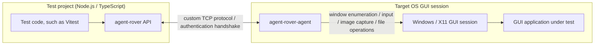

# agent-rover

A multi-platform TypeScript test driver for GUI applications


[](https://github.com/kekyo/agent-rover/)
[](https://www.repostatus.org/#wip)
[](https://opensource.org/licenses/MIT)

---

## What Is This?

Few problems are as painful as automated testing for GUI applications on Windows and X11.
agent-rover provides a driver interface for automated tests written in TypeScript in these environments.

> WIP: X11 agent



agent-rover provides small agent programs that can be used in Windows and X11 environments.
By starting an agent on the target OS, you can remotely operate applications from a Node.js environment through a Jest-like testing interface.
In other words, the operations that we humans perform against applications in a remote session over RDP can be done through an API.

Register the endpoint and its token in `$HOME/.agent-rover` first.

```ini
[default]
test-agent.example.com=<access-token>
```

With agent-rover, you can write test code like this:

```typescript
import { writeFile } from 'node:fs/promises';

import { connectRemoteAgent } from 'agent-rover';

// Connect to the remote agent.
const agent = await connectRemoteAgent();

// Save a file in the remote environment.
await agent.files.writeFile(
  String.raw`C:\test.txt`,
  Buffer.from('test text file')
);

// Launch the application.
const process = await agent.processes.launchManaged({
  path: 'notepad.exe',
});

// Get the application window.
const notepadWindow = await process.waitForWindow({
  visible: true,
});

// Activate the application.
await notepadWindow.activate();

// Enter text by simulating keyboard typing.
await agent.keyboard.pasteText('Here is a remote message');

// Capture the window image and save it.
const screenshot = await notepadWindow.screenshot();
await writeFile('capture.png', screenshot.image);

await process.releaseAsync();
```

In addition to observing and operating GUI applications themselves, agent-rover also includes APIs for operating the target GUI session.
As shown in the example above, you can send and receive files and launch applications.

## Features

- Place the agent application on a remote machine and drive test operations remotely.
- Launch, discover, operate, and inspect the state of target GUI applications.
  File operations, such as sending and receiving files, are also supported.
- Capture the screen or an application window as a PNG image, or as an H.264
  MP4 video on a supported Windows agent.
- Prebuilt agents are available for Windows (i686/amd64 on XP SP2 or later) and Linux X11 (i686/amd64/armv7l/arm64/riscv64).
- Agent communication uses a custom TCP protocol.
  Authentication uses a digest handshake, although the protocol messages themselves are not encrypted.
- Image recognition assertions for exact or close matches, and OCR-based assertions.

---

## Preparation

Download the agent for the target platform from the [releases page](https://github.com/kekyo/agent-rover/releases/).
Windows distributions are available as a ZIP and an installer. Both contain the same agent and require no Node.js runtime.

| Distribution | Usage |
| --- | --- |
| `agent-rover-agent-win32-{version}.zip` | Extract to a folder of your choice. Run `agent-amd64.exe` on 64-bit Windows or `agent-i686.exe` on 32-bit Windows. |
| `agent-rover-agent-win32-{version}-setup.exe` | Installs for the current user, by default in `%LOCALAPPDATA%\Programs\agent-rover`. Launch `agent-rover` from the Programs menu. |

The installer selects the executable for your OS and installs it as `agent-rover-agent.exe`.
Normal installation requires no administrator privileges and neither launches the agent nor registers startup at sign-in on first installation.
Before updating, choose `Exit` from the tray and install into the same folder.
If a file is in use, the update stops and preserves the existing files.
Use `/S` for silent installation. Failures return a nonzero exit code.

Uninstall through the Windows installed-apps list or the Programs menu's `Uninstall` shortcut.
Uninstallation preserves the INI file, logs, test data, and Defender settings.
Startup entries and shortcuts are removed only when they point to the installation being removed; entries for another copy are preserved.

For automated uninstallation, account for NSIS's launch behavior.
An ordinary `uninstall.exe /S` launches a temporary copy and exits first, so its exit code does not report whether removal succeeded.
To wait for completion and obtain the removal exit code, copy the installed `uninstall.exe` into a temporary folder you own and run that copy with `/S _?=<absolute installation path>`.
Place `_?=` last in the command line, without quoting its path even when it contains spaces. Wait for the copied process, read its exit code, and then remove the temporary copy.
This invocation returns a nonzero code when removal fails. See [NSIS exit codes and temporary copies](https://nsis.sourceforge.io/Docs/AppendixD.html#D.1).

Start the Windows agent from your interactive desktop. It runs in the system tray.

```cmd
C:\> agent-amd64.exe
```

By default, the agent accepts one driver connection at a time.
While a driver is connected, later connections receive `AGENT_BUSY` and are closed.
The agent remains busy during authentication and while stopping the previous
connection's operations and owned applications after disconnection.
When using a section, the driver advances to its next candidate. After all candidates
fail, it waits ten seconds and retries, up to 360 additional rounds by default.

To retain the previous behavior of accepting multiple connections, start the
agent with `--connection-mode multiple`. Use `--connection-mode single` to
explicitly select the default.

```cmd
C:\> agent-amd64.exe --connection-mode multiple
```

Double-click the tray icon or choose “Show logs” to open the viewer.
The version banner, token field and Copy button appear above the log list.
Use Copy to register the token in `$HOME/.agent-rover` on the driver machine.
When you supply a token with `--unsafe-token` or the agent INI, the token field and Copy button are hidden.
Closing the viewer keeps the agent running; choose “Exit” from the tray to stop it.

Logs include connection, authentication and process events, request IDs and
methods, execution results, response transmission and elapsed time. Sequence
numbers match between the viewer and files. Authentication tokens, request
bodies, environment variables and clipboard contents are not copied to logs.

The default TCP port is 39397. Open it in the OS firewall.
Start the Windows agent from the user's interactive desktop. Running it as a Windows service is not supported.

Then install agent-rover in your npm project:

```bash
npm install -D agent-rover
```

You can use any test framework.
For example, with Vitest, you can write the following:

```typescript
import { describe, expect, it } from 'vitest';
import { connectRemoteAgent } from 'agent-rover';

describe('remote agent smoke test', () => {
  it('finds a running Notepad window', async () => {
    // Connect to the remote agent.
    const agent = await connectRemoteAgent();

    try {
      // Enumerate windows.
      const windows = await agent.windows();
      // Is notepad.exe running?
      const hasNotepad = windows.some((window) => {
        return (
          window.visible && window.process.name.toLowerCase() === 'notepad.exe'
        );
      });
      expect(hasNotepad).toBe(true);
    } finally {
      // Release the remote agent.
      agent.release();
    }
  });
});
```

### Windows Agent Configuration And Startup

Save agent startup settings in `$HOME/.agent-rover-agent.ini`.
If `HOME` is empty or unset, the agent uses the current user's Windows profile, normally `C:\Users\username\.agent-rover-agent.ini`.
An explicit `HOME` must be an absolute path to an existing directory. The log viewer shows the actual INI path.
This file is separate from `.agent-rover`, which the SDK and `arctl` use to choose connection endpoints.

Choose `Open config file` from the tray to edit the INI.
If it does not exist, the agent creates a commented template and opens it in the associated application.
The template does not copy current command-line values or authentication tokens.
If no application is associated, open the reported path in Notepad.
After saving, choose `Exit` from the tray and start the agent again to apply changes. Existing connections and automatic recovery retain the startup configuration.

```ini
[agent]
host=0.0.0.0
port=39397
connection-mode=single
max-transfer-size=512
no-auth=false
; unsafe-token=replace-with-your-own-token
; safe-base-dir=C:\RoverWork
```

`safe-base-dir` is the suggested directory for test files. Create the folder before configuring it.
The SDK exposes it through `agent.files.safeBaseDir()`, and `agent.files.mkdtemp('case-')` creates a new workspace underneath it.

| INI key | Startup option | Default |
| --- | --- | --- |
| `host` | `--host` | `0.0.0.0` |
| `port` | `--port` | `39397` |
| `connection-mode` | `--connection-mode` | `single`; `multiple` is also supported. |
| `max-transfer-size` | `--max-transfer-size` | 512 MiB per transfer |
| `no-auth` | `--no-auth`, `-n` | `false`, enabling authentication. |
| `unsafe-token` | `--unsafe-token` | Generated at startup when authentication is enabled. |
| `safe-base-dir` | `--safe-base-dir` | The remote OS's standard temporary directory |

Ordinary settings use command-line values first, then INI values, then defaults.
An explicit authentication option replaces both `no-auth` and `unsafe-token` from the INI.
Combining `--no-auth` with `--unsafe-token`, or combining INI `no-auth=true` with a nonempty `unsafe-token`, is an error.
With `no-auth=false` and an absent or empty token, the agent generates a new token without writing it to the INI.

Save the INI as UTF-8 or UTF-16LE with a BOM; new templates use the latter.
Use the lowercase section and key names above. Duplicate or unknown names are errors.
Blank lines and comment lines beginning with `;` or `#` are accepted. Surrounding whitespace and a pair of enclosing double quotes are removed from values.
There are no inline comments, backslash escapes, or expansions of `%TEMP%`, `~`, or similar strings. Write actual absolute paths.
A missing INI is allowed; read or syntax errors produce a diagnostic and prevent startup. `--help` remains available with an invalid INI.

`Start at sign-in` in the tray toggles startup for the current user.
A checkmark means the current executable is registered. If another copy is registered, its path is shown; enabling startup replaces it with the current copy.
The registration contains only the quoted absolute executable path, without arguments or tokens.
Store settings needed at the next launch in the INI. Without a fixed token, a new token is generated on each launch.
After moving a ZIP installation, enable startup again from its new location. Paths producing a command longer than 260 characters cannot be registered.
Windows startup settings or policies may disable or delay execution. See [Windows Run key behavior](https://learn.microsoft.com/en-us/windows/win32/setupapi/run-and-runonce-registry-keys).

## Documents

For more information, [please visit the repository](https://github.com/kekyo/agent-rover/).

## License

Under MIT.
