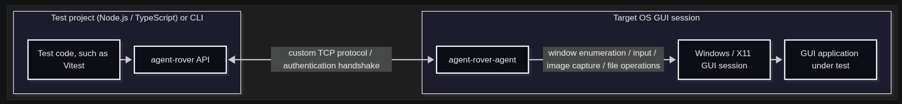
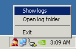
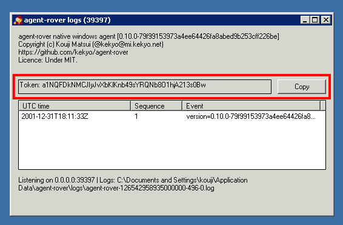

# agent-rover

A multi-platform TypeScript test driver for GUI applications


[](https://github.com/kekyo/agent-rover/)
[](https://www.repostatus.org/#wip)
[](https://opensource.org/licenses/MIT)

---

## What Is This?

Few problems are as painful as automated testing for GUI applications on Windows and X11.
agent-rover provides a driver interface for automated tests written in TypeScript in these environments.
Its command-line client, `arctl`, lets you connect to an agent and run one-off tasks.

> WIP: X11 agent



A small agent runs on the target OS and lets you control applications remotely from Node.js through a Jest-like testing interface.

The API lets you perform the same actions you would carry out manually in a remote desktop (RDP) session.

```typescript
import { writeFile } from 'node:fs/promises';

import { connectRemoteAgent } from 'agent-rover';

// Connect to the default remote agent.
const agent = await connectRemoteAgent();

// Save a file in the remote environment.
await agent.files.writeFile(
  String.raw`C:\test.txt`,
  Buffer.from('test text file')
);

// Launch the application.
const process = await agent.processes.launchManaged({
  path: 'notepad.exe',
});

// Get the application window.
const notepadWindow = await process.waitForWindow({
  visible: true,
});

// Activate the application.
await notepadWindow.activate();

// Enter text by simulating keyboard typing.
await agent.keyboard.pasteText('Here is a remote message');

// Capture the window image and save it.
const screenshot = await notepadWindow.screenshot();
await writeFile('capture.png', screenshot.image);

await process.releaseAsync();
```

The SDK can also transfer files and launch applications on the target machine.
For one-off operations, run `arctl` on the driver machine.

```bash
# Upload a directory
arctl put -r ./runtime 'C:\work\runtime'

# Download a directory
arctl get -r 'C:\work\results' ./results

# Take a screenshot
arctl screenshot ./screen.png

# Record ten seconds of video
arctl record ./screen.mp4 --seconds 10 --fps 30
```

## Features

- Place the agent application on a remote machine and drive test operations remotely.
- Launch, discover, operate, and inspect the state of target GUI applications.
  File operations, such as sending and receiving files, are also supported.
- Capture the screen or an application window as a PNG image, or as an H.264
  MP4 video on a supported Windows agent.
- Prebuilt Windows agents target Windows XP SP2 and later on i686 and amd64.
  The Linux X11 agent is in development for i686, amd64, armv7l, arm64, and riscv64.
- Agent communication uses a custom TCP protocol.
  Authentication uses a digest handshake, although the protocol messages themselves are not encrypted.
- Image recognition assertions for exact or close matches, and OCR-based assertions.

---

## Usage

Start the agent on the machine that hosts the GUI application. The test driver connects to it from a second machine.

### Windows Agent Setup

Download the Windows installer or portable ZIP for the target machine from the [releases page](https://github.com/kekyo/agent-rover/releases/).

| Distribution | Usage |
| --- | --- |
| `agent-rover-agent-win32-{version}-setup.exe` | Install for the current user, then launch `agent-rover` from the Programs menu. |
| `agent-rover-agent-win32-{version}.zip` | Extract to a folder of your choice. Run `agent-amd64.exe` on 64-bit Windows or `agent-i686.exe` on 32-bit Windows. |

You can also start the agent from the command line in your Windows desktop session.
Once it starts, right-click its system tray icon to open the menu.



Double-click the tray icon or choose `Show logs` to open the log viewer.



The version banner, access token, and `Copy` button appear above the log list.
Choose `Copy` and paste the token into `$HOME/.agent-rover` on the driver machine.
In the following example, we register a token as the 'default' remote agent:

```ini
[default]
test-agent.example.com=<access-token>
```

> If you supply a token with `--unsafe-token` at startup or in the agent's configuration file, the viewer hides the token field and the `Copy` button.

Closing the viewer keeps the agent running. Choose `Exit` from the tray menu to stop it.

Logs include connection, authentication and process events, request IDs and
methods, execution results, response transmission and elapsed time. Sequence
numbers match between the viewer and files. Authentication tokens, request
bodies, environment variables and clipboard contents are not copied to logs.

The default TCP port is 39397. Open it in the OS firewall.
Start the Windows agent from the user's interactive desktop. Running it as a Windows service is not supported.

### Writing a Test Driver

Install agent-rover in your test project.

```bash
npm install -D agent-rover
```

You can use any test framework. This Vitest example checks for a visible Notepad window.

```typescript
import { describe, expect, it } from 'vitest';
import { connectRemoteAgent } from 'agent-rover';

describe('remote agent smoke test', () => {
  it('finds a running Notepad window', async () => {
    // Connect using the [default] section of .agent-rover.
    const agent = await connectRemoteAgent();

    try {
      // Enumerate windows.
      const windows = await agent.windows();
      // Is notepad.exe running?
      const hasNotepad = windows.some((window) => {
        return (
          window.visible && window.process.name.toLowerCase() === 'notepad.exe'
        );
      });
      expect(hasNotepad).toBe(true);
    } finally {
      // Release the remote agent.
      agent.release();
    }
  });
});
```

For the operations available to test code, see the [test driver API reference](https://github.com/kekyo/agent-rover#reference).

---

## Documents

- For logs, startup settings, test directories, process supervision, and limits, see [Agent Configuration Details](https://github.com/kekyo/agent-rover#agent-configuration-details).
- For `arctl` commands, recording options, and connection settings, see [Test Driver Configuration Details](https://github.com/kekyo/agent-rover#test-driver-configuration-details).

## License

Under MIT.
